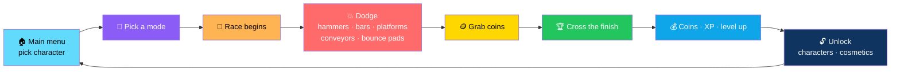

# 🎢 WOBBLY WORLD

<div align="center">


**A colourful, chaotic 3D obstacle-racing game that runs in the browser.**

*Pick a wobbly character. Race six AI rivals. Survive the swinging hammers.*

[🚀 Getting Started](#-getting-started) • [🎮 Controls](#-controls) • [🎯 Modes](#-modes) • [🏗️ Architecture](#-project-structure) • [🔧 Extending](#-how-to-add-a-new-obstacle)

</div>

---

## 📖 Overview

**WOBBLY WORLD** is a **colourful, chaotic 3D obstacle-racing game** that runs in the browser.

Race **six AI rivals** through **swinging hammers, spinning bars, falling platforms, conveyor belts, and bounce pads** — grab coins, level up, and unlock new characters and cosmetics.

### Core Idea

> **Wobbly physics. Chaotic courses. Pure fun.**
>
> **Pick a wobbly character and race six AI rivals** — **playable with keyboard OR touch controls.**

### The Race Flow



---

## ✨ Features

<div align="center">

| 🏃 Third-Person Controller | 🎨 8 Procedural Characters |
|:---:|:---:|
| **Rapier physics world** · **stable capsule collider** · **separate animated mesh** | **Squash-and-stretch** · **face animations** · **stumble/recover** · **victory dance** |
| **🗺️ 5 Levels · 4 Worlds** | **🧱 8 Obstacle Types · 4 Surfaces** |
| **Candy Land** *(2)* · **Lava Factory** · **Sky Adventure** · **Toy City** | **Hammers · rotating bars · ferry platforms · moving walls · rolling balls · falling platforms · disappearing tiles · punching blocks** · **slippery · conveyor · bounce · normal surfaces** |
| **🤖 Waypoint/Probe-Based AI** | **🎮 5 Game Modes** |
| **Jumps gaps** · **waits for obstacle gaps** · **makes funny mistakes** · **recovers by returning to its last checkpoint — NEVER teleports forward** | **Classic Race** · **Time Trial** · **Challenge** *(3 objectives)* · **Survival** *(3 lives)* · **Endless Run** *(procedurally generated)* |
| **🪙 Progression** | **🔊 Procedural Audio** |
| **Coins · XP · player levels · 13 achievements · character & cosmetic shop · personal bests · daily reward** | **No audio files** · **nothing plays before the first user interaction** · **particle effects** |
| **📱 Complete Mobile Support** | **⚙️ Settings** |
| **Virtual joystick · Jump and Sprint buttons · multi-touch · left-handed mode · control size/opacity · safe-area insets · rotate-device hint** *(non-blocking)* · **vibration** | **Graphics quality · volumes · camera distance · touch control options** · **progress saved in `localStorage` and validated on load** |

</div>

---

## 🛠️ Tech Stack

<div align="center">

| Library | Role |
|---------|------|
| **React 19** | UI |
| **TypeScript** | Language |
| **Vite** | Build tool |
| **Three.js** | 3D rendering |
| **React Three Fiber** | React renderer for Three.js |
| **Drei** | R3F helpers |
| **`@react-three/rapier`** | Physics |
| **Zustand** | State |
| **Tailwind CSS 4** | Styling |
| **Howler.js** | Audio |

</div>

---

## 🚀 Getting Started

```bash
npm install
npm run dev        # development server with hot reload
npm run build      # type-check + production build into dist/
npm run preview    # serve the production build locally
```

**Requires Node 18+** *(developed on Node 22)*.

---

## 🎮 Controls

### ⌨️ Keyboard

<div align="center">

| Action | Key |
|:------:|:---:|
| **Move** | **`W A S D` / arrow keys** |
| **Jump** *(hold for a higher jump)* | **`Space`** |
| **Sprint** *(stamina-limited)* | **`Shift`** |
| **Pause** | **`Esc`** |

</div>

> 💡 **Movement is camera-relative.** The camera follows the course direction, so **"up" on the stick always means "toward the finish."**

### 📱 Mobile Controls

<div align="center">

| Control | Details |
|:-------:|---------|
| **Joystick** *(bottom-left)* | **360° · dead zone · normalized diagonals · returns to neutral on release/cancel** |
| **JUMP** *(large, bottom-right)* | Works while moving — tracks its own finger |
| **RUN** *(sprint, hold)* | Works while moving — tracks its own finger |

</div>

### 🛡️ Input Safety

> **Inputs reset safely on:**
>
> - **Pointer cancel**
> - **Lost capture**
> - **Tab switch**
> - **Orientation change**
> - **Page hide**

### ⚙️ Touch Settings

> **Settings → touch controls:** **size (S/M/L) · opacity · dead zone · left-handed mode · vibration · Auto/On/Off visibility**

> 💡 **Landscape is recommended** — **portrait shows a dismissible hint and still works.**

---

## 🎯 Modes

<div align="center">

| Mode | What It Is |
|:----:|------------|
| **🏁 Classic Race** | **You + 6 AI rivals** — **results computed from real finishing order and times** |
| **⏱️ Time Trial** | **Solo run** — **personal best saved per level** |
| **🎯 Challenge** | **Speed Run** *(beat par)* · **Coin Hunter** *(80% of coins)* · **Clean Run** *(no falls or bonks)* |
| **❤️ Survival** | **Generated course** · **3 lives** · **higher difficulty** · **scored by distance** |
| **♾️ Endless Run** | **Long generated course** with rising difficulty · **"End run" in the pause menu banks your distance** |

</div>

---

## 🏗️ Project Structure

```
src/
├── app/                  App.tsx (root, WebGL check, audio unlock)
│                         router.tsx (menu / race screen switch)
│
├── components/ui/        MainMenu · GameHUD · PauseMenu
│                         ResultsScreen · LoadingScreen
│                         SettingsPanel · Widgets
│
├── game/
│   ├── GameCanvas.tsx · RaceScene.tsx · MenuScene.tsx
│   │   GameManager.ts · GameConfig.ts
│   │
│   ├── characters/       CharacterModel (visuals)
│   │                     CharacterController (movement rules)
│   │                     RacerBody (physics body)
│   │                     Player · AICharacter
│   │                     CharacterAnimations · CharacterData
│   │
│   ├── controls/         InputManager · KeyboardInput
│   │                     VirtualJoystick · ActionButton
│   │                     TouchControls
│   │
│   ├── physics/          PhysicsWorld (runtime registry)
│   │                     CollisionManager (ray casts, hazard tests)
│   │                     MovementController
│   │
│   ├── camera/           FollowCamera
│   │
│   ├── obstacles/        one component per obstacle
│   │                     + ObstacleManager (type → component registry)
│   │
│   ├── levels/           LevelConfig (helpers, worlds)
│   │                     LevelManager · Course
│   │                     EndlessGenerator · LevelView
│   │                     levels/*.ts
│   │
│   ├── worlds/           CandyWorld · LavaWorld
│   │                     SkyWorld · ToyCityWorld
│   │                     (scenery, lights, sky)
│   │
│   └── systems/          RaceManager · AIManager
│                         CheckpointManager · RewardManager
│                         AudioManager · SaveManager
│                         ParticleSystem · Effects
│
├── store/                gameStore · playerStore · settingsStore
│                         (Zustand)
│
├── hooks/                useGameControls · useMobileControls
│
└── types/ utils/ styles/
```

### 🎯 Design Principles

<div align="center">

| Principle | Implementation |
|:---------:|---------------|
| **⚡ Fast state stays out of React** | **Gameplay state lives in plain TypeScript singletons** *(`RaceManager`, `registry`)* — **mirrored into Zustand only ~10× per second for the HUD** — **the 3D simulation never triggers React re-renders** |
| **⏱️ Deterministic simulation clock** | **Obstacles are driven from `registry.time`** — **which keeps them pause-safe AND lets the AI predict where hazards will be** |
| **🤖 AI plays fair** | **Waypoint/probe-based** · **jumps gaps** · **waits for obstacle gaps** · **recovers by returning to its last checkpoint** — **NEVER teleports forward** |
| **🎨 Zero third-party assets** | **All characters, levels, sounds, and music are original and generated procedurally in code** |
| **🔊 Audio waits for the user** | **Nothing plays before the first user interaction** |
| **💾 Saves validated on load** | **Bad data falls back to defaults** — **corrupt saves can't break the game** |
| **🛡️ Cosmetics are cosmetic** | **Cosmetics never touch movement constants** |
| **📱 Mobile is complete** | **Joystick · JUMP · RUN · multi-touch · left-handed · safe-area · vibration · rotate hint** |

</div>

---

## 🎛️ How to Add a New Obstacle

**Four steps:**

### 1. Define the variant

**Add a variant to `ObstacleDef` in `src/types/level.ts`.**

### 2. Create the component

**Create `src/game/obstacles/MyObstacle.tsx`:**

- **Use a `RigidBody type="kinematicPosition"`** for collision
- **Drive it from `registry.time`** in `useFrame`
- **Register what the AI / hit-test needs** in `useEffect`:

<div align="center">

| Register | Purpose |
|:--------:|---------|
| **`registry.hazards.set(id, { id, knockback, shapes: (t) => Shape[] })`** | **For things that bonk the player** |
| **`registry.surfaces.set(body.handle, info)`** | **For moving ground** *(riders inherit `vx/vz`)* |
| **`registry.softGrounds.set(id, …)`** | **For ground that moves or vanishes** — **so the AI times its jumps** |

</div>

### 3. Register it

**Add it to `OBSTACLE_COMPONENTS` and `obstacleColor` in `ObstacleManager.ts`.**

### 4. Use it in a level

```js
{ type: 'my', pos: [0, 0, -40], … }
```

---

## 🗺️ How to Add a New Level

**Three steps:**

### 1. Create the config file

**Create `src/game/levels/levels/<world>-NN.ts` exporting a `LevelConfig`** *(see `candy-01.ts`)*.

**Platforms are described by their top-surface height** — **`plat(x, z, width, depth, y?, opts?)` is the helper.**

**Provide:**

- **`waypoints`** *(the course center line)*
- **`spawn`**
- **`finish`**
- **`checkpoints`**
- **`coins`**
- **`killY`**
- **`parTime`**
- **`aiSkill`**

### 2. Register it

**Add it to the `LEVELS` array in `LevelManager.ts`** — **array order is the unlock order.**

### 3. Keep it completable

> ⚠️ **Keep gaps ≤ 6 units** *(sprint-jump reach is ~7.5)* — **so every level stays completable.**

---

## 📈 Progression & Saving

### 💾 Storage

<div align="center">

| Data | Key |
|:----:|-----|
| **Coins, XP, levels, unlocks, personal bests, achievements** | **`wobbly-world-save-v1`** |
| **Settings** | **`wobbly-world-settings-v1`** |

</div>

> ✅ **Both are validated field-by-field on load** — **bad data falls back to defaults.**

### 🔄 Reset

**Settings → *Reset progress*** erases the save **after a confirmation step**.

> 💡 **Cosmetics are purely visual** — **they never touch movement constants.**

---

## 🧪 Testing

> **Debug hooks for headless testing.**

<div align="center">

| Hook | Purpose |
|:----:|---------|
| **`window.__ww`** | **Exposes the stores and `RaceManager` for debugging** |
| **`window.__wwAutopilot = true`** | **Lets the AI brain drive the player** |

</div>

> 💡 **This was used to drive every level start-to-finish in headless Chromium.**

### Typical Test

```js
__ww.useGameStore.getState().startRace('candy-01', 'classic');
// then watch __ww.RaceManager.player
```

---

## 🔧 Troubleshooting

<div align="center">

| Problem | Solution |
|:-------:|----------|
| **Black/blank screen or "needs WebGL"** | **Enable hardware acceleration or update your browser** — **try Settings → Quality: Low** |
| **Low frame rate** | **Use Low quality** *(default on touch devices)* — **the renderer also lowers its pixel ratio automatically** |
| **No sound** | **Browsers block audio until you click/tap once** — **check Settings → volumes** |
| **Touch controls not showing on a hybrid laptop** | **Settings → Show touch controls → On** |
| **Progress lost** | **Private/incognito windows and cleared site data wipe `localStorage`** |
| **Large bundle warning on build** | **Expected** *(Three.js + Rapier WASM)* — **the app is a single chunk** |

</div>

---

## 🚢 Deploying to Vercel

### Via the Dashboard

1. **Push the repository to GitHub/GitLab**
2. In Vercel choose **Add New → Project** and import the repo — **framework preset *Vite* is detected; `vercel.json` is included**
3. **Build command `npm run build`**, **output directory `dist`** — **deploy**

### Via the CLI

```bash
npm i -g vercel && vercel --prod
```

---

## 🗺️ Roadmap

### ✅ Current

- [x] React 19 + TypeScript + Vite foundation
- [x] Three.js with React Three Fiber and Drei
- [x] Rapier physics with a stable capsule collider and separate animated mesh
- [x] Third-person character controller
- [x] 8 procedural characters with squash-and-stretch, face animations, stumble/recover, and victory dance
- [x] 5 playable levels across 4 worlds — Candy Land *(2)*, Lava Factory, Sky Adventure, Toy City
- [x] 8 obstacle types — hammers, rotating bars, ferry platforms, moving walls, rolling balls, falling platforms, disappearing tiles, punching blocks
- [x] 4 surface types — slippery, conveyor, bounce, normal
- [x] Waypoint/probe-based AI that jumps gaps, waits for obstacle gaps, makes funny mistakes, and recovers from checkpoints
- [x] AI never teleports forward
- [x] 5 fully implemented game modes — Classic Race, Time Trial, Challenge, Survival, Endless Run
- [x] Three challenge objectives — Speed Run, Coin Hunter, Clean Run
- [x] Endless Run with generated course, rising difficulty, and distance banking
- [x] Coins, XP, player levels, personal bests, and a daily reward
- [x] 13 achievements
- [x] Character and cosmetic shop
- [x] Fully procedural audio with no audio files and nothing playing before first user interaction
- [x] Particle effects
- [x] Complete mobile support — virtual joystick, Jump and Sprint buttons, multi-touch, left-handed mode, control size and opacity, safe-area insets, rotate-device hint, vibration
- [x] Safe input resets on pointer cancel, lost capture, tab switch, orientation change, and page hide
- [x] Settings for graphics quality, volumes, camera distance, touch control options
- [x] Progress saved in `localStorage` and validated on load
- [x] Gameplay state in plain TypeScript singletons mirrored into Zustand at ~10× per second
- [x] Deterministic simulation clock for obstacles
- [x] Obstacle and level extension paths documented
- [x] Debug hooks for headless testing with AI autopilot
- [x] Deployable to Vercel with included `vercel.json`
- [x] Zero third-party assets

### 🔜 Future Ideas

- [ ] **Additional worlds** beyond the current 4
- [ ] **Additional characters** beyond the current 8
- [ ] **Additional obstacle types**
- [ ] **Additional game modes**
- [ ] **Local leaderboards** — beyond personal bests
- [ ] **Online multiplayer racing**
- [ ] **Level editor** — visual course building
- [ ] **Ghost replay** — race your own best run
- [ ] **Sound pack variants**
- [ ] **Localization** — bilingual UI

---

## 🤝 Contributing

Contributions are welcome. Please:

1. Fork the repository
2. **Keep gameplay state out of React** — singletons with 10× per second Zustand mirroring
3. **Keep obstacles driven from `registry.time`** — pause-safety and AI prediction depend on it
4. **Keep the AI fair** — it must never teleport forward
5. **Keep everything procedural** — no third-party assets
6. **Keep cosmetics cosmetic** — never touch movement constants
7. **Keep saves validated** — bad data must fall back to defaults
8. **Follow the documented extension paths** for new obstacles and levels
9. **Add tests for any new mechanic** — the `__ww` hooks are the seam
10. Submit a Pull Request

### Guidelines

- **Never let the 3D simulation trigger React re-renders**
- **Never break the deterministic clock**
- **Never leak movement constants into cosmetics**
- **Never break `localStorage` compatibility** without a migration path
- **Never present a stub as a feature**

---

## 📜 License

MIT — see [LICENSE](LICENSE) for details.

---

## 🙏 Acknowledgments

- **All characters, levels, sounds, and music are original and generated procedurally in code — no third-party assets.**
- **Rapier** — for a physics engine that keeps a wobbly character feeling stable
- **React Three Fiber** — for making a chaotic 3D world feel like a React tree
- **Every player who's ever laughed at a wobbly stumble** — this one's for you

---

<div align="center">

### 🎢 RUN. JUMP. WOBBLE. WIN.

**A colourful, chaotic 3D obstacle-racing game that runs in the browser.**

**Six AI rivals. Five modes. Four worlds. Zero third-party assets.**

<br>

⭐ If WOBBLY WORLD made you smile, consider giving it a star.

<br>

[⬆ Back to Top](#-wobbly-world)

</div>
